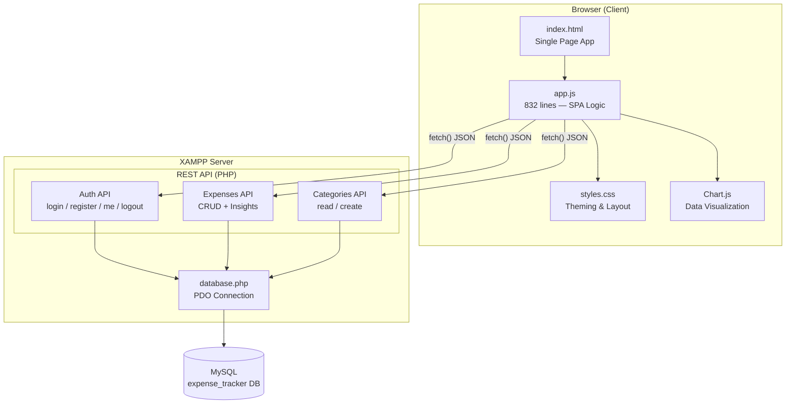
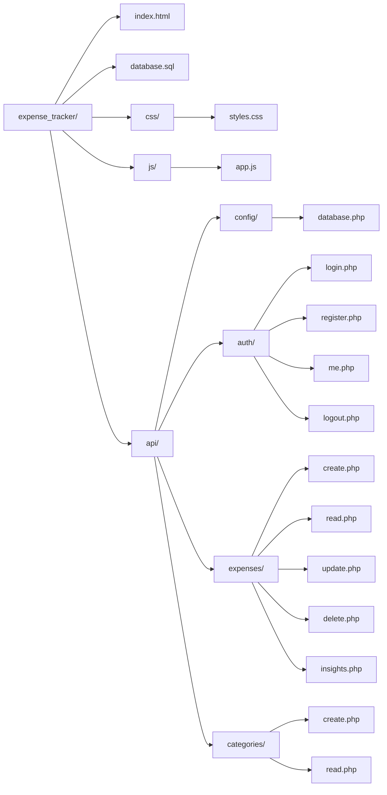
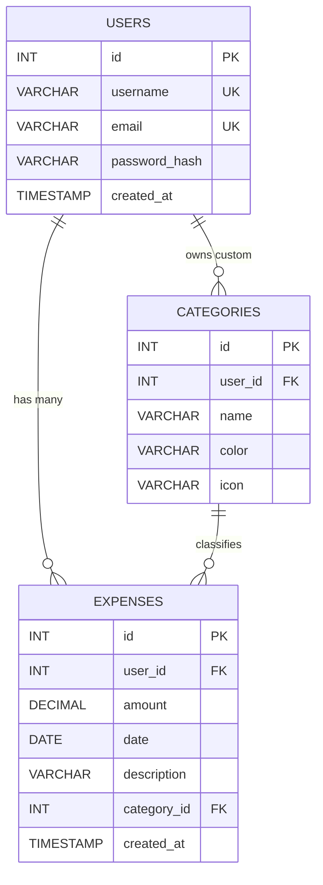
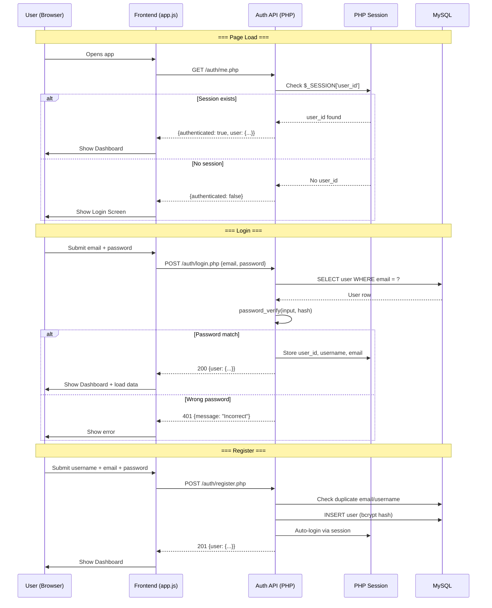
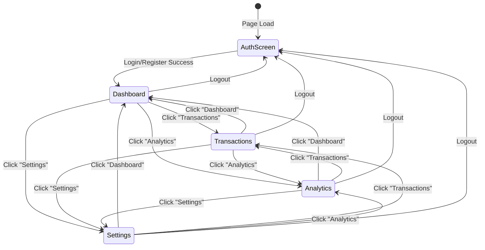
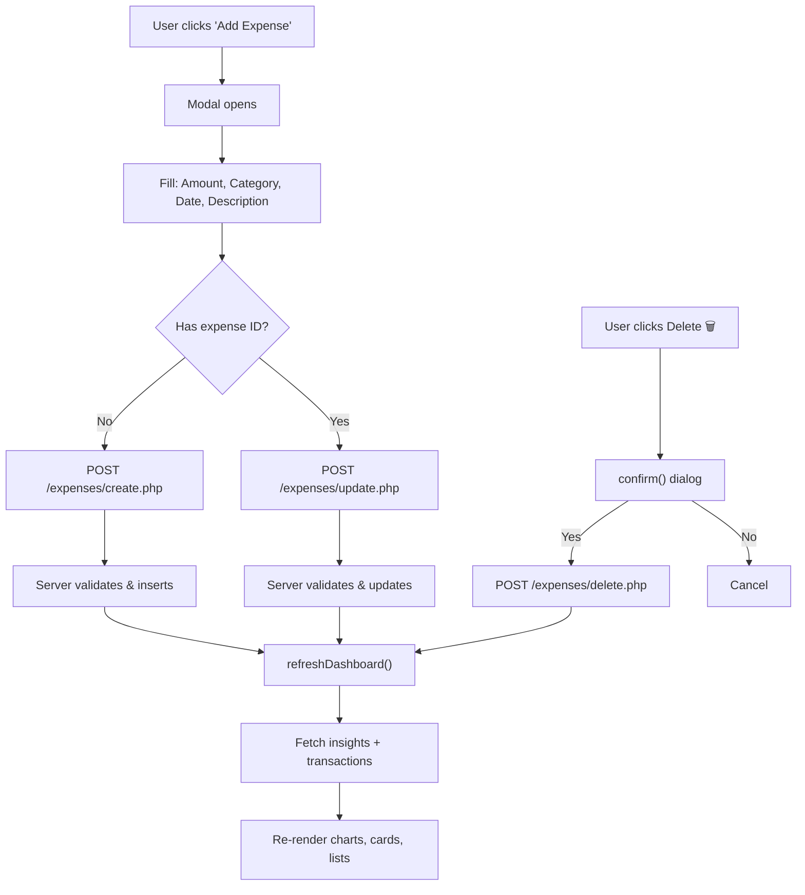
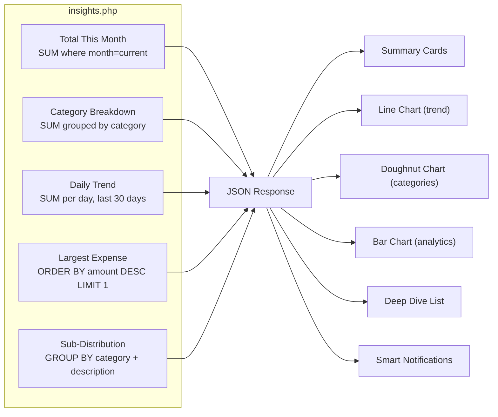
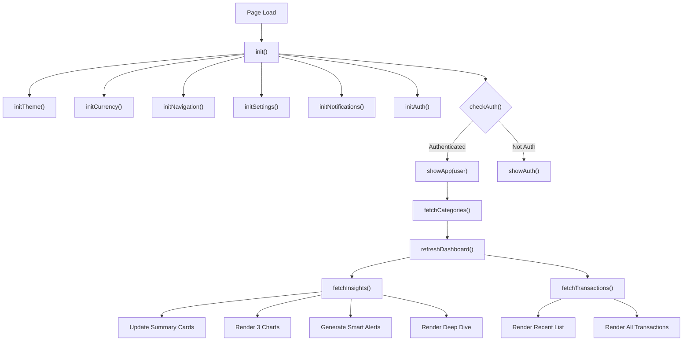
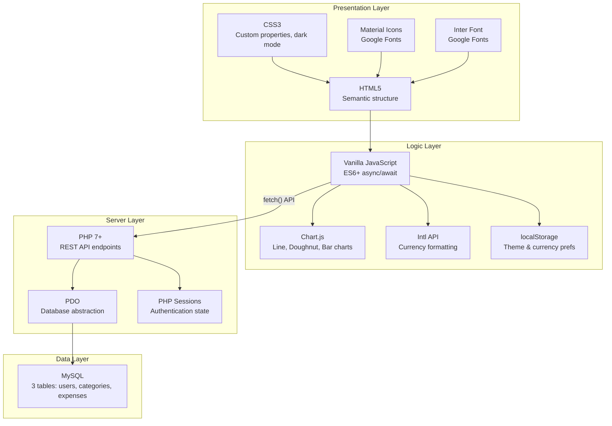

# 🎯 Trackr — Expense Tracker Application

> A full-stack **Single Page Application (SPA)** for personal expense management with authentication, analytics, smart alerts, and multi-currency support.

---

## 📌 Project Overview

| Attribute | Detail |
|---|---|
| **App Name** | Trackr |
| **Type** | Full-Stack SPA |
| **Frontend** | HTML5 + Vanilla JS + CSS3 + Chart.js |
| **Backend** | PHP 7+ REST API |
| **Database** | MySQL (via PDO) |
| **Server** | XAMPP (Apache + MySQL) |
| **Auth** | Session-based (bcrypt hashing) |

---

## 🏗️ High-Level Architecture

---

## 📂 File Structure

---

## 🗃️ Database Schema (ER Diagram)

> **Key Points:**
> - `categories.user_id` can be `NULL` → shared default categories (Housing, Food, Transport, etc.)
> - User-created categories are private (`user_id = owner`)
> - All expenses are scoped to `user_id` for multi-user isolation
> - Cascade deletes ensure cleanup when a user is removed

---

## 🔐 Authentication Flow

---

## 🧭 SPA Navigation Flow

> Navigation works by toggling `display: none/block` on `view-section` divs — no page reloads.

---

## 🔌 REST API Endpoints

| Method | Endpoint | Auth? | Purpose |
|--------|----------|-------|---------|
| `POST` | `/api/auth/register.php` | ❌ | Create new user account |
| `POST` | `/api/auth/login.php` | ❌ | Authenticate & start session |
| `GET` | `/api/auth/me.php` | ✅ | Check current session |
| `POST` | `/api/auth/logout.php` | ✅ | Destroy session |
| `GET` | `/api/categories/read.php` | ✅ | List all categories |
| `POST` | `/api/categories/create.php` | ✅ | Add custom category |
| `POST` | `/api/expenses/create.php` | ✅ | Add new expense |
| `GET` | `/api/expenses/read.php` | ✅ | List user expenses |
| `POST` | `/api/expenses/update.php` | ✅ | Edit existing expense |
| `POST` | `/api/expenses/delete.php` | ✅ | Remove expense |
| `GET` | `/api/expenses/insights.php` | ✅ | Analytics & aggregations |

---

## 📊 Expense CRUD Flow

---

## 📈 Insights Engine (insights.php)

The insights endpoint aggregates **5 data points** in a single call:

---

## 🎨 Key Features Summary

### 1. Split-Screen Authentication
- Premium SaaS-style login/register with visual branding panel
- Form toggle animation between Login ↔ Register

### 2. Dashboard View
- **Summary Cards**: Total monthly expenses, average daily spend
- **Trend Chart**: Line chart of last 30 days (gradient fill)
- **Category Doughnut**: Proportional spending breakdown
- **Recent Transactions**: Last 5 entries with edit/delete

### 3. Transactions View
- Complete scrollable list of all user expenses
- Each row shows category icon, color, amount, date, description
- Inline edit & delete actions

### 4. Analytics View
- Largest single expense highlight
- Top spending category card
- Bar chart comparing all categories
- **Category Deep Dive**: Sub-distribution showing individual items within each category

### 5. Settings View
- Add custom categories (name + color + Material Icon)
- Currency override (USD, EUR, GBP, INR, AUD, CAD)
- Auto-detect currency by timezone

### 6. Smart Notifications 🔔
- Auto-generated alerts based on spending data
- Monthly total tracker, largest expense warning, top category insight

### 7. Dark Mode 🌙
- One-click toggle with `data-theme` attribute
- Persisted in `localStorage`
- Charts re-render with theme-appropriate colors

---

## 🔒 Security Features

| Feature | Implementation |
|---|---|
| Password Hashing | `password_hash()` with `PASSWORD_BCRYPT` |
| Password Verification | `password_verify()` |
| SQL Injection Prevention | PDO Prepared Statements with `bindParam` |
| XSS Prevention | `htmlspecialchars(strip_tags())` on inputs |
| Session-based Auth | `$_SESSION` with server-side validation |
| Data Isolation | All queries filtered by `user_id` |
| Cascade Deletes | FK constraints with `ON DELETE CASCADE` |

---

## 🔄 Application Lifecycle

---

## 🛠️ Tech Stack Diagram

---

## 🚀 How to Run

1. **Start XAMPP** → Enable Apache + MySQL
2. **Import Database** → Run `database.sql` in phpMyAdmin
3. **Open Browser** → Navigate to `http://localhost/expense_tracker/`
4. **Register** → Create an account and start tracking!

---

> **Total Codebase**: ~17 files | Frontend SPA (~17K HTML + ~33K JS + ~19K CSS) | Backend REST API (11 PHP files) | 1 SQL schema
